# Poorest Decile

Daniela Avayu

## What is your current goal? Has it changed since the proposal?

My current goal is to identify and visualize development indicators that help explain whether improvements in average global welfare have been shared equally across the income distribution, especially among the poorest global decile. This goal is consistent with my original proposal. 

## Are there data challenges you are facing? Are you currently depending on mock data?

My main data challenge is the abundance of available data and the need to narrow the project without losing focus. I am using real data from the World Bank's Poverty and Inequality Platform and Data360, rather than relying on mock data, so I also need to be careful about differences in definitions, years, and population weighting across sources. I have a pretty complete panorama of what is going on but I still dont know how to incorporate the development indicators to the narrative. 

## Describe each of the provided images with 2-3 sentences to give the context and how it relates to your goal.

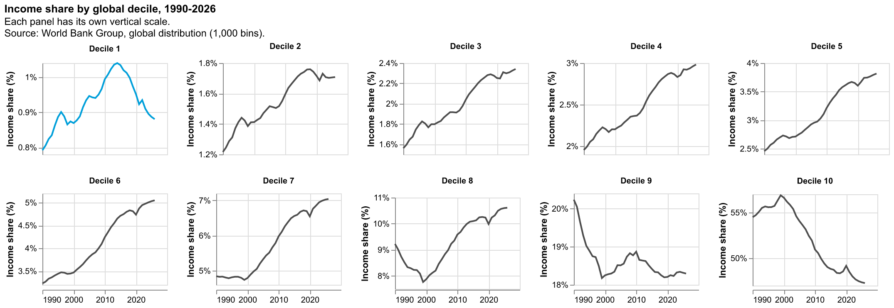

These separate line charts show how global income shares changed across the ten population deciles from 1990 to 2026. The richest deciles consistently capture the largest shares, while the poorest 10% receives only a very small fraction of total global income, highlighting the persistence of global inequality over time. 

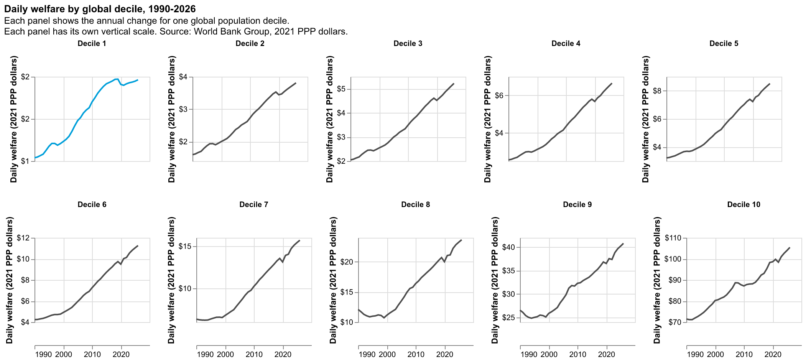

This small-multiples chart shows how mean daily welfare changes over time for each global income decile. It makes it possible to compare improvements across the distribution while keeping attention on the much lower welfare levels experienced by the poorest deciles.

## Visualization 3. Relative changes in mean welfare

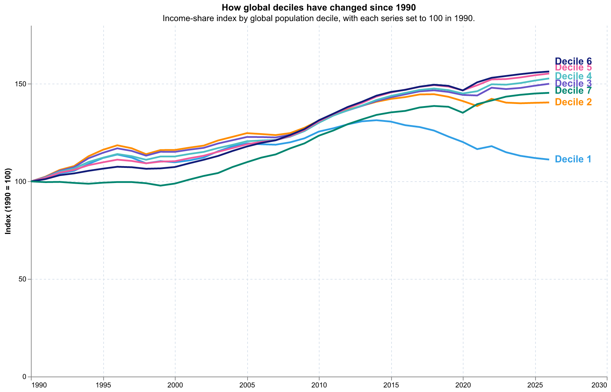

This line chart shows how mean welfare in each global decile changed relative to its 1990 level, which is indexed to 100. The poorest decile increases only modestly and ends well below the gains experienced by most higher deciles, suggesting that welfare growth has not been distributed evenly across the population.

## Visualization 4. Malawi deciles compared with the corresponding global deciles

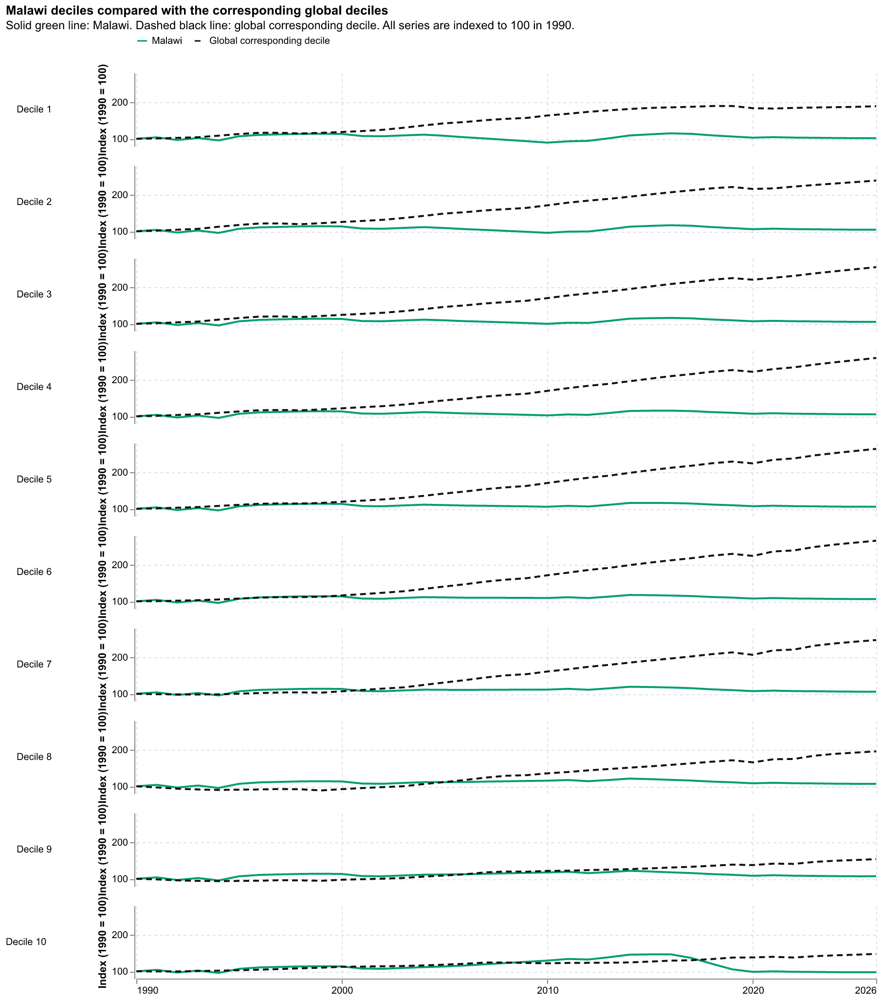

This figure compares the trajectories of Malawi's population deciles with the corresponding global deciles, with all series indexed to 100 in 1990. I explored several countries in this way, and selected Malawi to show how a low-income country's welfare gains can remain relatively limited while the corresponding global deciles experience much stronger growth.

## Visualization 5. Rwanda deciles compared with the corresponding global deciles

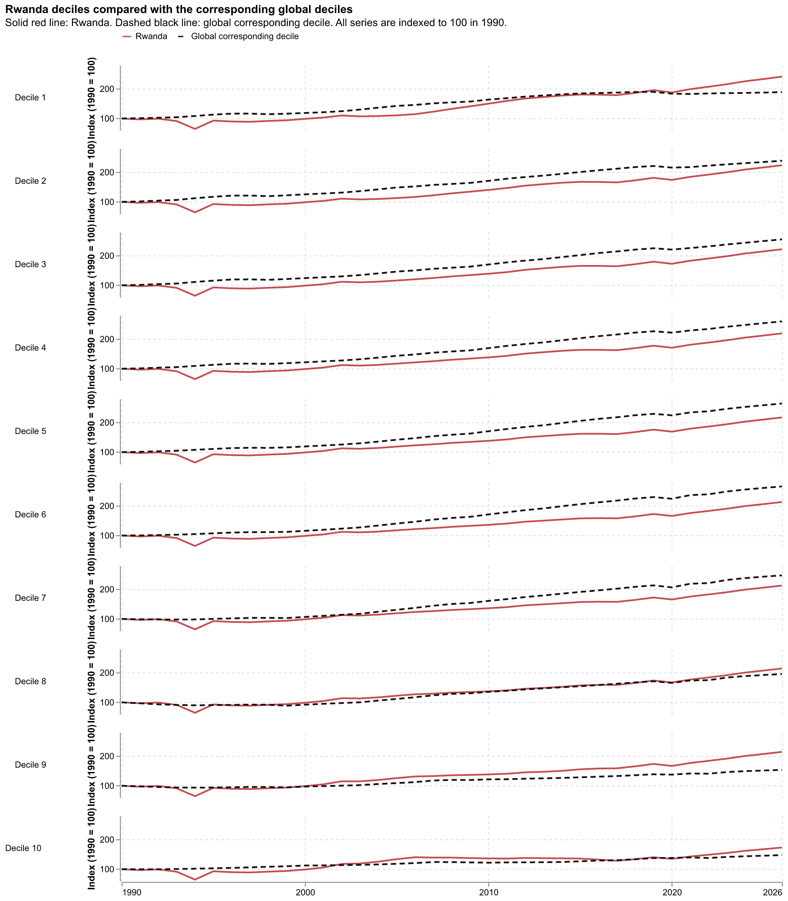

This figure provides a contrast with Malawi by showing Rwanda's decile trajectories alongside the corresponding global deciles, again indexed to 100 in 1990. Rwanda shows stronger growth across the distribution, illustrating how national progress can differ substantially from the experience of another low-income country even when both are compared with the same global benchmarks.

## Visualization 6. Growth by global decile compared with global average growth

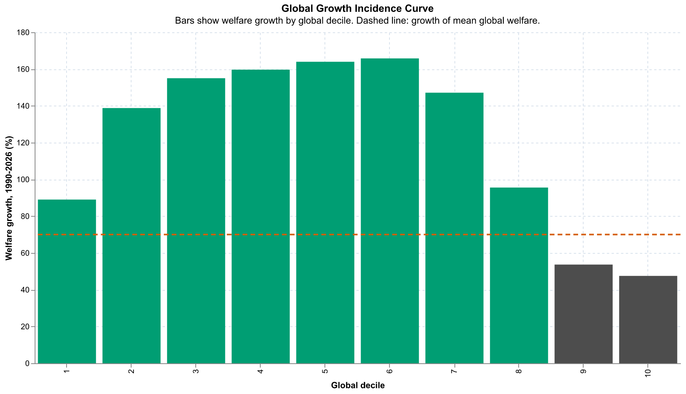

This chart compares welfare growth between 1990 and 2026 across global deciles, with the dashed line showing average global welfare growth. Growth is highest among the middle deciles, while the richest two deciles grow below the global average, showing that aggregate progress can be distributed unevenly without following a simple pattern in which the richest always gain the most.

## Visualization 7. The welfare ratio between the richest and poorest deciles

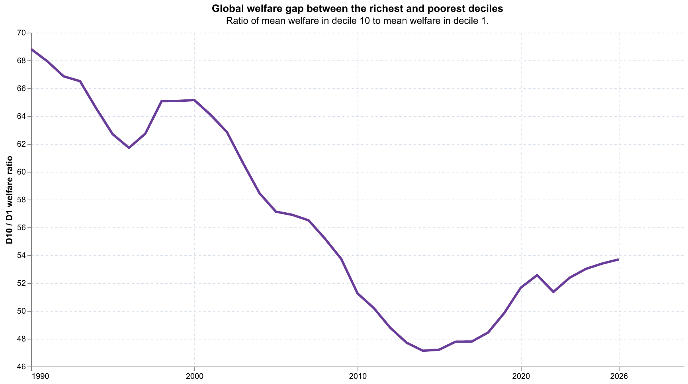

This line chart tracks the ratio between mean welfare in the richest 10% and the poorest 10% over time. The gap narrows from roughly 69 times in 1990 to around 47 times in the mid-2010s, but it remains very large and rises again toward 2026, showing that improvements in relative inequality have not eliminated the distance between the two groups.

## Visualization 8. Change in income share by global decile

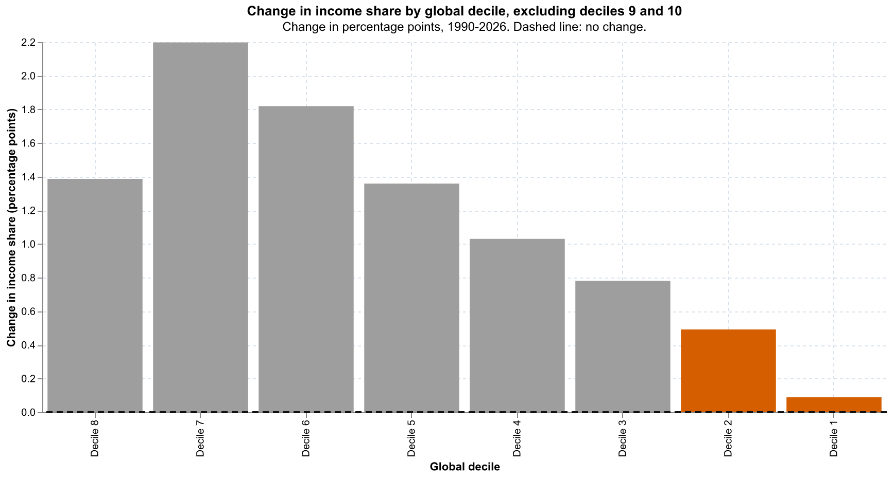

This bar chart shows the change in income share, measured in percentage points, between 1990 and 2026 for global deciles 1 through 8. The lower deciles, especially deciles 1 and 2, experience only small gains, while the largest increases occur among the middle deciles.

## Visualization 9. The global population distribution in 1990 and 2020

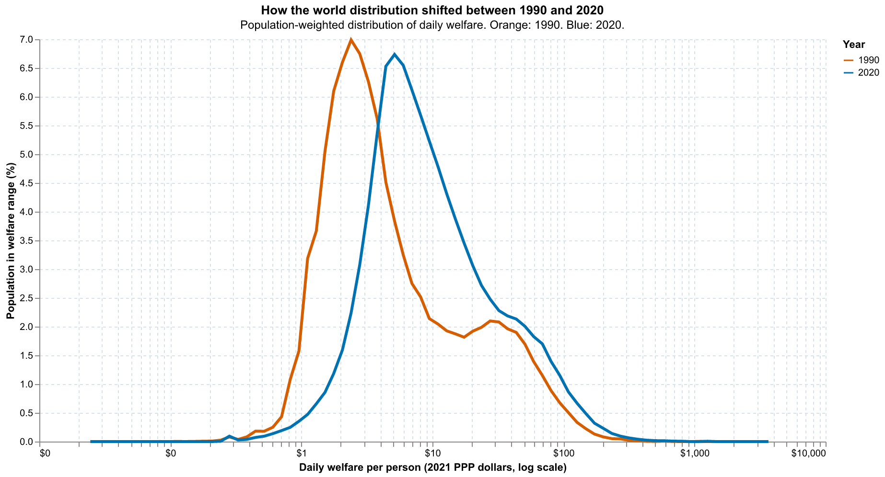

This chart compares the population-weighted distribution of daily welfare in 1990 and 2020 on a logarithmic scale. The distribution shifts to the right, indicating broad global progress, but the persistent lower tail shows that a substantial population still remains at very low welfare levels.

## Visualization 10. D1 headcount compared with the $3 poverty line

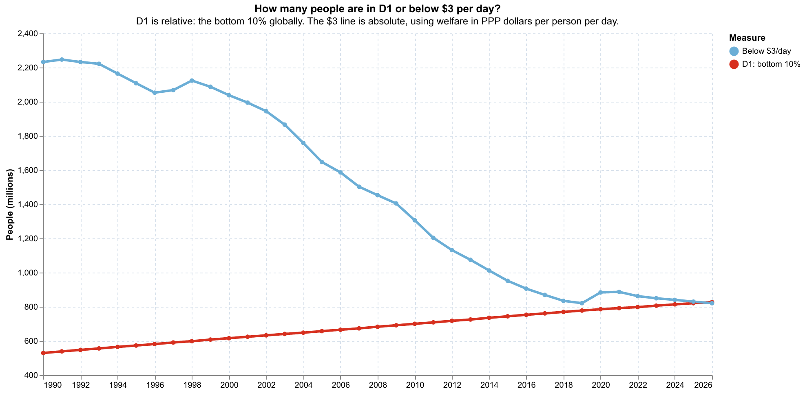

This chart compares two different ways of identifying disadvantage: the global poorest decile, which always represents the bottom 10% of the population, and the number of people living below $3 per day. The population below the absolute poverty line falls substantially over time and converges toward the size of the global D1, showing both the reduction in extreme poverty and the persistence of a sizeable poorest group.

## Visualization 11. Which countries have the largest share of their population in D1?

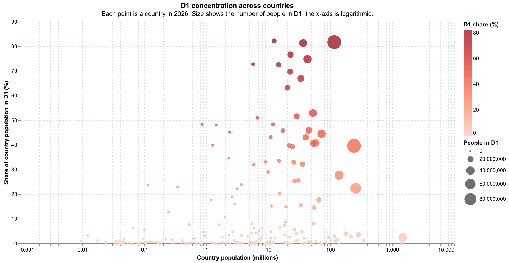

This scatterplot shows the share of each country's population that belongs to the global poorest decile in 2026. Country population is shown on a logarithmic x-axis, while point size represents the absolute number of people in D1, making it possible to distinguish countries with high D1 concentration from countries contributing large numbers of people to the global poorest decile. In 13 countries, more than 50% of the population is in D1: Burundi, the Central African Republic, the Democratic Republic of the Congo, the Republic of the Congo, Madagascar, Mozambique, Malawi, Niger, Somalia, South Sudan, Uganda, Yemen, and Zambia.

## What form do you envision your final narrative taking? (e.g. An article incorporating the images? A poster? An infographic?)

I envision the final narrative as a blog post for the World Bank Data Blog, combining visual evidence with a clear explanation of how global progress can coexist with persistent disadvantage among the poorest decile.