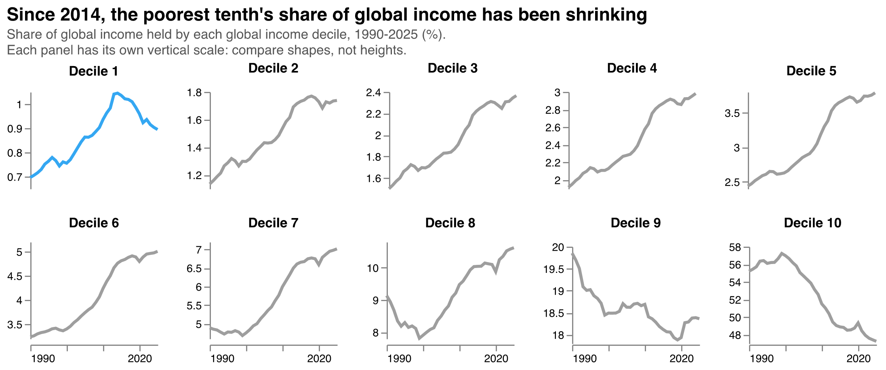
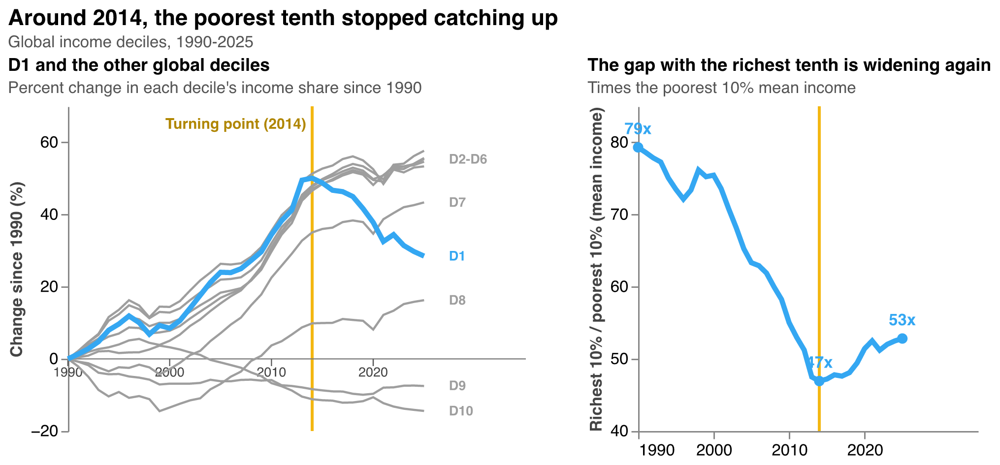
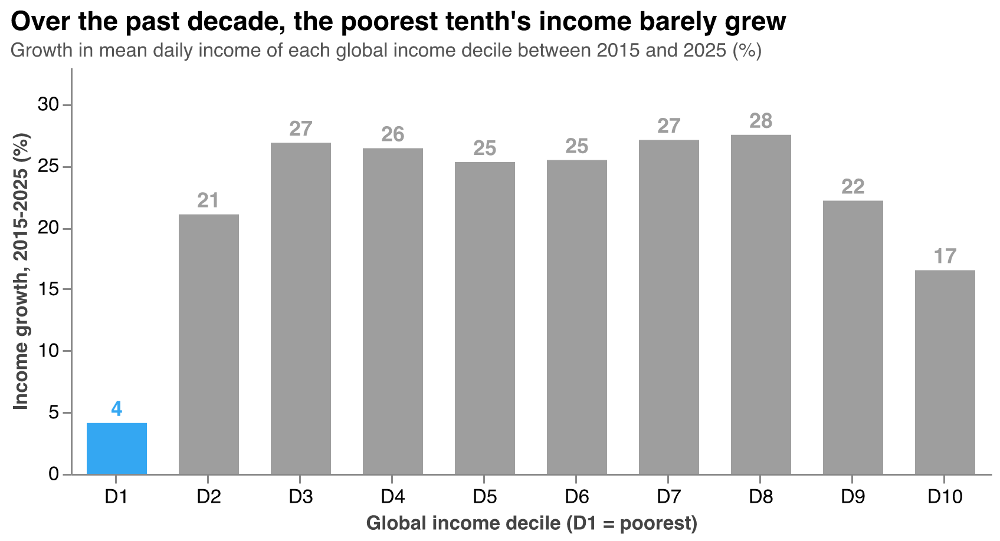
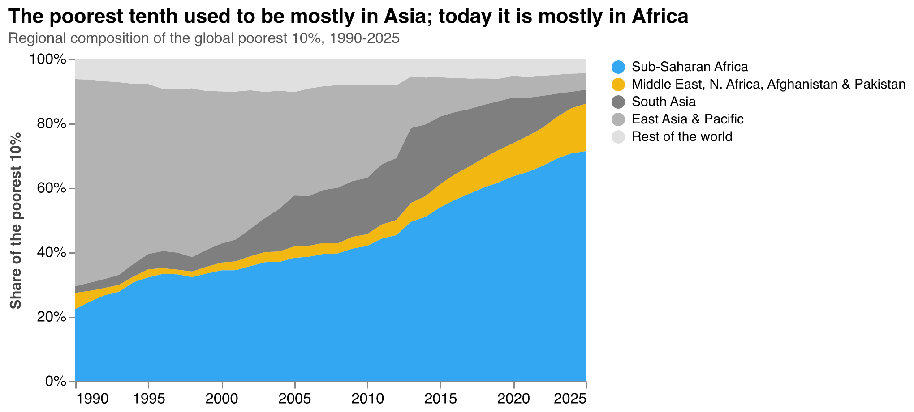
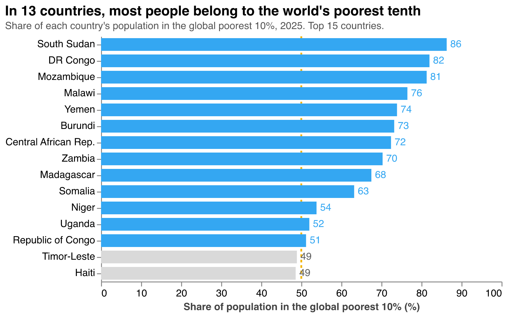
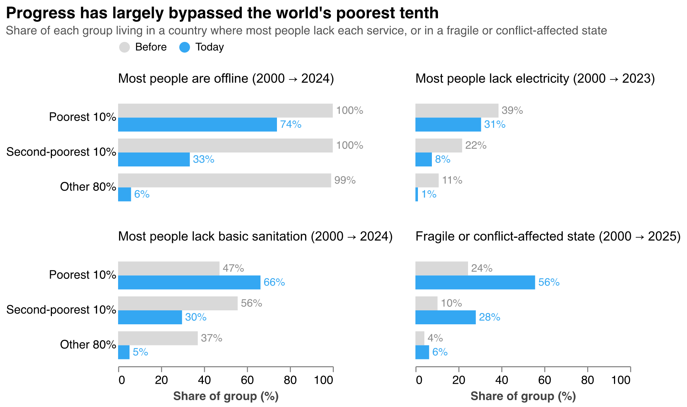

Public debate and economic research have focused on the extraordinary accumulation of income and wealth at the top. From the Forbes Billionaires List to the systematic accounting of the income shares held by the top 1% and 0.1%, attention naturally gravitates toward the rich.

These metrics matter. When a wealthy minority captures a disproportionate share of total income, it can lead to political capture, as institutional rules shift to protect incumbent capital. It can also restrict social mobility by concentrating high-quality opportunities, and erode social cohesion and institutional trust. When the very top keeps a firm grip on wealth, opportunities and political influence, everyone else, including those at the bottom, has a harder time improving their well-being.

Yet measures such as the income share of the top 1% do not directly reveal how the most vulnerable households are faring.

**What if we flipped the lens?** Instead of tracking the top, this note tracks the bottom of the global income distribution: the poorest 10% of the world's population - a position occupied by roughly 820 million people in 2025. Who sits in that position changes over time, as some people grow out of it and others remain; we return to that below. What matters is whether the bottom of the distribution moves with everyone else.

## The bottom 10% is falling behind

In a perfectly equal world, the bottom 10% would receive 10% of global income. In reality, it receives less than 1%. That share rose slowly for nearly 25 years, from 0.70% in 1990 to a peak of 1.04% in 2014. Since then it has been falling, back to 0.89% in 2025. The middle deciles kept gaining share over the same period, the second decile has stalled since 2015, and the richest tenth has lost share gradually since around 2000. Only the bottom 10% went from steady gains to a sharp decline.

{width=100%}

Put side by side, the divergence is stark. Measured against 1990, every decile from the second to the seventh now holds 43-58% more of global income. The bottom 10% kept pace until the early 2010s; since then its share has fallen back, but remains 28% above its 1990 level. The gap with the top tells the same story. In 1990, average income in the richest tenth was 79 times that in the poorest tenth. By 2014 the gap had narrowed to 47 times; since then it has widened again, to 53 times in 2025. This reversal does not hinge on recent projections: it is already visible by 2019, before the pandemic and in years with broader survey coverage, when the bottom 10%'s share had fallen to 0.99% and the gap had widened to 49 times.

{width=95%}

The reversal is not the result of a global slowdown. Over the past decade, average income rose by around a quarter in the middle of the global distribution. At the bottom 10%, it rose by about 4%, far slower than the rest. Even the next 10% up, which is also very poor, grew about five times faster.

{width=100%}

## Who is at the bottom, and where

The turning point makes sense once we look at who occupies the bottom 10%. In 1990, almost two-thirds of the people in it lived in East Asia; China alone accounted for more than half. As China and then India grew rapidly, hundreds of millions of people moved out of the bottom of the global distribution. India's share of the bottom 10% peaked at about a fifth in the early 2010s and is now 3%. Today, 71% of the people in the bottom 10% live in Sub-Saharan Africa, and another 15% in the Middle East, North Africa, Afghanistan and Pakistan.

After 2014, the remaining Asian groups kept moving up, and the bottom 10% became increasingly made up of people in slow-growing economies. From then on, the position stopped improving: the bottom of the distribution is now a place that global growth has barely reached.

{width=100%}

The bottom 10% is also concentrated in a small group of countries. In 13 of them, from South Sudan and the Democratic Republic of Congo to Madagascar and Niger, most of the population falls in the global bottom 10%. Together, they account for about 290 million people, more than a third of the bottom tenth.

{width=90%}

Most of these countries share a profile: weak state capacity, recurring conflict, economies dominated by subsistence agriculture, and limited basic infrastructure. Several factors can help explain why the bottom of the distribution is decoupling from global progress:

1. **Fragility and conflict.** Global poverty is increasingly concentrated in conflict-affected and fragile states. When basic security and institutions collapse, development is hard to sustain.
2. **Exposure to shocks.** The bottom 10% relies disproportionately on subsistence agriculture and informal rural work. Extreme weather increasingly wipes out their assets and income, while they lack social protection to absorb the shocks.
3. **The digital and infrastructure divide.** Growth increasingly depends on digital infrastructure. Without reliable electricity or internet access, the bottom 10% is largely shut out of modern supply chains and the productivity gains they bring. Artificial intelligence may widen this gap further: countries where most people are offline or lack power are poorly positioned to benefit from AI-driven productivity gains.
4. **Debt distress.** High sovereign debt distress in low-income nations forces governments to prioritize debt servicing over foundational public investments like primary education, public health, and basic infrastructure, limiting their ability to raise living standards.

## Not just income: services and fragility

The data on basic services and fragility point the same way. Over the past two decades, progress has reached most of the world but largely bypassed its bottom tenth. Each comparison below asks the same question at two points in time: what share of the people in each group live in a country where most people lack a given service?

**Internet use** is the clearest case of a gap opening up. In 2000, almost everyone lived in a country where most people were offline. Today, 74% of the people in the bottom 10% still do, compared with 33% in the second decile and 6% in the other 80%. **Electricity** shows a similar stall: since 2000, the share of the bottom 10% living in a country where most people lack power has fallen only from 39% to 31%, while for the second decile it dropped from 22% to 8%. On **basic sanitation**, the picture has worsened for the bottom 10%: 66% now live in a country where most people lack a basic toilet, up from 47% in 2000, even as the share fell from 56% to 30% for the second decile and from 37% to 5% for the rest of the world. **Fragility** follows the same pattern: 56% of the bottom 10% now live in a fragile or conflict-affected state, up from 24% in 2000, compared with 28% of the second decile and 6% of everyone else.

{width=100%}

Across all four measures, the bottom 10% is not just behind. It is increasingly alone at the bottom.

## What it means

The risk for global inequality in the coming decades may not only be that the top 1% accumulates too much, but that the bottom of the distribution stops catching up. Even if some people move out of it, a part of the world risks being left behind, with far less access to both income growth and basic services, while the rest moves on. Measuring inequality from the bottom makes that risk visible, and it points to where policy attention is most needed: fragile states, basic infrastructure, and the shocks that keep the poorest from climbing out.



## Data and methods

**Global income distribution.** The analysis starts from the World Bank's Poverty and Inequality Platform (PIP), which represents each country's income (or consumption) distribution with 1,000 bins per year. This analysis covers 1990 to 2025; the release also includes a 2026 forecast, which is not used. Each bin covers one-thousandth of the country's population and records average daily income (or consumption) per person in that bin, in 2021 PPP dollars. For years after a country's latest household survey, PIP extrapolates the distribution using national accounts growth, so the most recent years are estimates rather than direct observations.

*From bins to global deciles.* For each year separately:

1. All bins from all countries are pooled into a single list and sorted from lowest to highest daily income.
2. Each bin is weighted by the number of people it represents (one-thousandth of national population).
3. Population is accumulated along the sorted list, and each bin is assigned to a global decile according to where it falls: the first 10% of the world's population is decile 1 (D1, the bottom 10%), the next 10% is decile 2, and so on up to decile 10.
4. For each decile, mean daily income is the population-weighted average across its bins. A decile's **income share** is its mean income divided by the sum of the ten decile means; because each decile holds about 10% of the population, this equals its share of total global income. **Growth rates** compare decile means across years.

Three implications follow. First, deciles are *global*: a person in Burundi and a person in India are ranked against each other, not within their own countries. Second, deciles are recalculated every year, so the bottom 10% is a position in the distribution, not a fixed group of people; who occupies it changes as some people's incomes rise past others'. Third, each bin is assigned whole to one decile, so each decile holds between 9.98% and 10.02% of world population rather than exactly 10%, a negligible difference.

*Distribution source.* All figures based on the global income distribution use the World Bank's 2026 PIP release of the 1,000-bin distribution (vintage 20260922), stored in `GlobalDist1000bins_1990_2026_20260922_2021_01_02_PROD.csv`. The file includes each bin's welfare value, represented population, country code and region. Income shares, mean incomes, growth rates, regional composition and country concentration are all calculated from this same file. Service-access indicators and fragility status come from their separate sources, described below.

**Services.** For each indicator, a country is classified as *low access* if fewer than half of its population has the service: access to electricity (World Bank WDI), individuals using the internet (ITU), and at least basic sanitation services (WHO/UNICEF JMP, via WDI). Each bar shows the share of a group's population that lives in a low-access country. This is a country-level classification: it describes where people live, not whether each individual has the service.

**Fragility.** World Bank lists of fragile and conflict-affected situations (FCV) for fiscal years 2001 and 2026, matched to the 2000 and 2025 income distributions. The lists come from the GPID-WB/class repository (https://github.com/GPID-WB/class).

**Years.** "Before" is 2000 for services and fragility. "Today" is 2023 for electricity, 2024 for internet and sanitation, and 2025 for fragility. Countries without data for a given indicator and year are excluded from that calculation.
