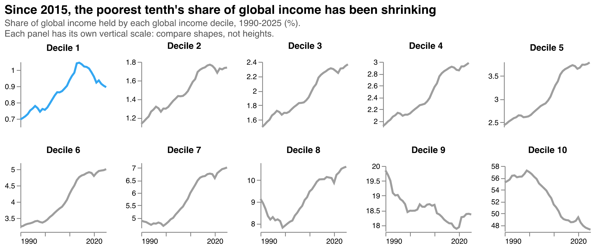
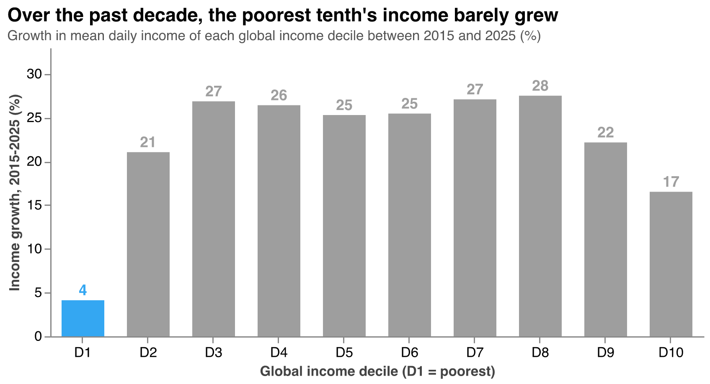
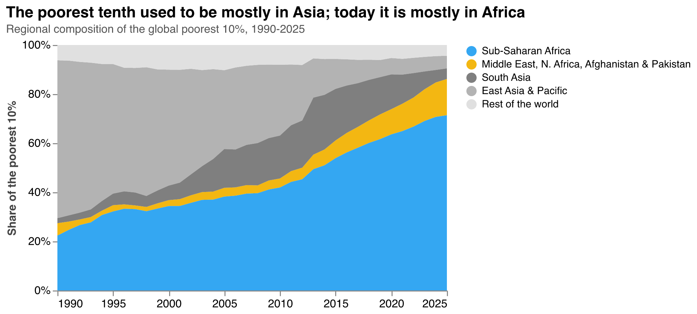
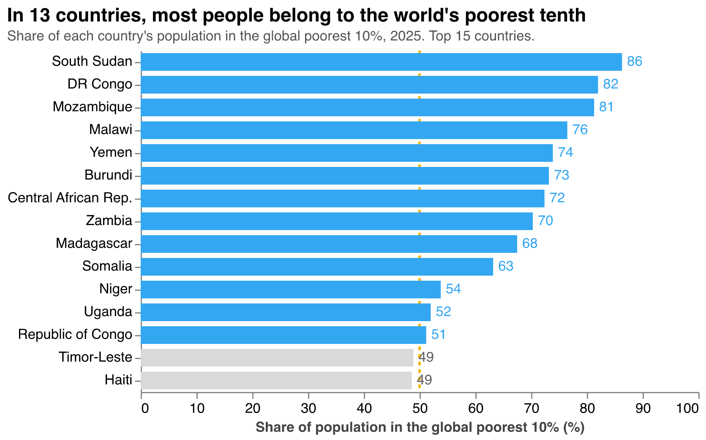
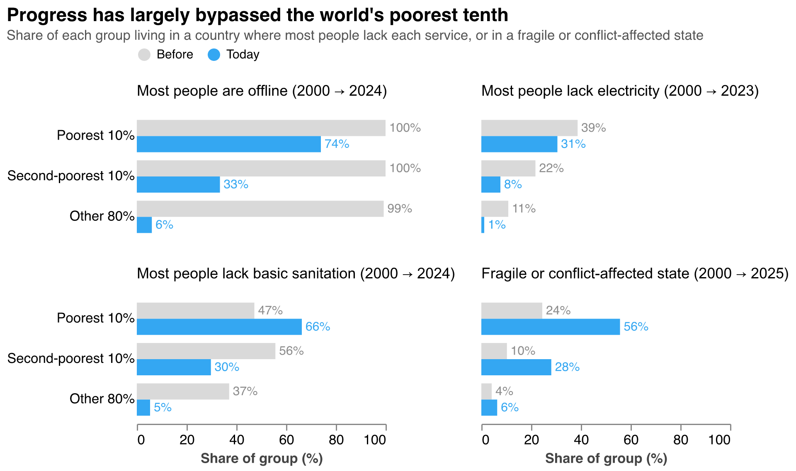

Public debate and economic research have focused on the extraordinary accumulation of income and wealth at the top. From the Forbes Billionaires List to the systematic accounting of the income shares held by the top 1% and 0.1%, attention naturally gravitates toward the rich.

These metrics matter. When a wealthy minority captures a disproportionate share of total income, it can lead to political capture, as institutional rules shift to protect incumbent capital. It can also restrict social mobility by concentrating high-quality opportunities, and erode social cohesion and institutional trust. When the very top keeps a firm grip on wealth, opportunities and political influence, everyone else, including those at the bottom, has a harder time improving their well-being.

Yet measures such as the income share of the top 1% do not directly reveal how the most vulnerable households are faring.

What if we flipped the lens? Instead of tracking the top, this blog looks at the bottom of the global income distribution: the poorest 10% of the world's population - a position occupied by roughly 820 million people in 2025.

## The bottom 10% is falling behind

In a perfectly equal world, the bottom 10% would receive 10% of global income. In reality, it receives less than 1%. That share rose slowly for nearly 25 years, from 0.70% in 1990 to a peak of 1.04% in 2014. Since then it has been falling, back to 0.89% in 2025. The middle deciles kept increasing their share over the same period, while the richest tenth has lost share gradually since around 2000.

{width=100%}

When tracking inequality, it matters whether one focuses on the top or the bottom. If inequality is proxied by the share of income going to the top 10%, we would find that the world is getting gradually more equal. Yet this finding reverses in the last decade if we give priority to the very poorest.

A falling income share does not by itself mean stagnation: the bottom 10% could still be growing quickly if the other deciles were growing faster. Yet that is not what has happened.

Over the past decade, incomes for the bottom 10% hardly moved, increasing in total by 4%. Meanwhile, it rose by around a quarter in the middle of the global distribution. Even the second decile, which is also very poor, grew about five times faster than the very poorest.

{width=100%}

## Who is at the bottom, and where

The turning point makes sense once we look at who occupies the bottom 10%. In 1990, almost two-thirds of the people in it lived in East Asia; China alone accounted for more than half. As China and then India grew rapidly, hundreds of millions of people moved out of the bottom of the global distribution. India's share of the bottom 10% peaked at about a fifth in the early 2010s and is now 3%. Today, 71% of the people in the bottom 10% live in Sub-Saharan Africa, and another 15% in the Middle East, North Africa, Afghanistan and Pakistan.

{width=100%}

The bottom 10% is also concentrated in a small group of countries. In 13 of them, from South Sudan and the Democratic Republic of Congo to Madagascar and Niger, most of the population falls in the global bottom 10%.

{width=90%}

Many of these countries share a profile: weak state capacity, recurring conflict, economies dominated by subsistence agriculture, and limited basic infrastructure. Several factors can help explain why the bottom of the distribution is decoupling from global progress:

1. **Fragility and conflict.** Global poverty is increasingly concentrated in conflict-affected and fragile states. When basic security and institutions collapse, development is hard to sustain.
2. **Exposure to shocks.** The bottom 10% relies disproportionately on subsistence agriculture and informal rural work. Extreme weather increasingly wipes out their assets and income, while they lack social protection to absorb the shocks.
3. **The digital and infrastructure divide.** Growth increasingly depends on digital infrastructure. Without reliable electricity or internet access, the bottom 10% is largely shut out of modern supply chains and the productivity gains they bring. Artificial intelligence may widen this gap further: countries where most people are offline or lack power are poorly positioned to benefit from AI-driven productivity gains.
4. **Debt distress.** High sovereign debt distress in low-income nations forces governments to prioritize debt servicing over foundational public investments like primary education, public health, and basic infrastructure, limiting their ability to raise living standards.

To illustrate how some of these factors increasingly dominate the bottom 10%, we ask the same question at two points in time: what share of the people in the bottom 10% live in a country where most people lack a given service?

**Internet use** is the clearest case of a gap opening up. In 2000, almost everyone lived in a country where most people were offline. Today, 74% of the people in the bottom 10% still do, compared with 33% in the second decile and 6% in the other 80%. **Electricity** shows a similar stall: since 2000, the share of the bottom 10% living in a country where most people lack power has fallen only from 39% to 31%, while for the second decile it dropped from 22% to 8%. On **basic sanitation**, the picture has worsened for the bottom 10%: 66% now live in a country where most people lack basic sanitation, up from 47% in 2000, even as the share fell from 56% to 30% for the second decile and from 37% to 5% for the rest of the world. **Fragility** follows the same pattern: 56% of the bottom 10% now live in a fragile or conflict-affected state, up from 24% in 2000, compared with 28% of the second decile and 6% of everyone else. Across all four measures, the bottom 10% is increasingly alone at the bottom.

{width=100%}

## What it means

Regardless of what happens to the top of the income distribution, the risk for global inequality in the coming decade may be that the bottom of the distribution is left at the station, with far less access to basic services, while the rest moves on. Measuring inequality from the bottom makes that risk visible, and it points to where policy attention is most needed: fragile states, basic infrastructure, and the shocks that keep the poorest from climbing out.

The full data and methods behind these figures are available in the project's GitHub repository: [insert link].